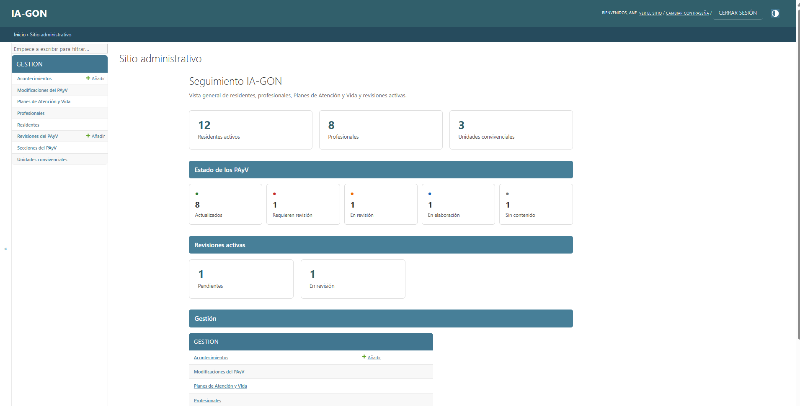
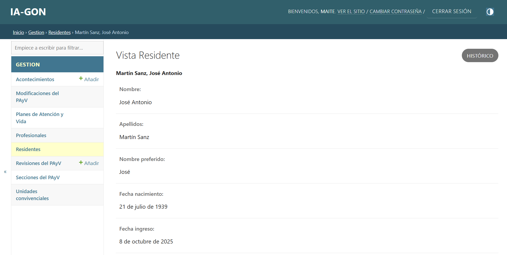
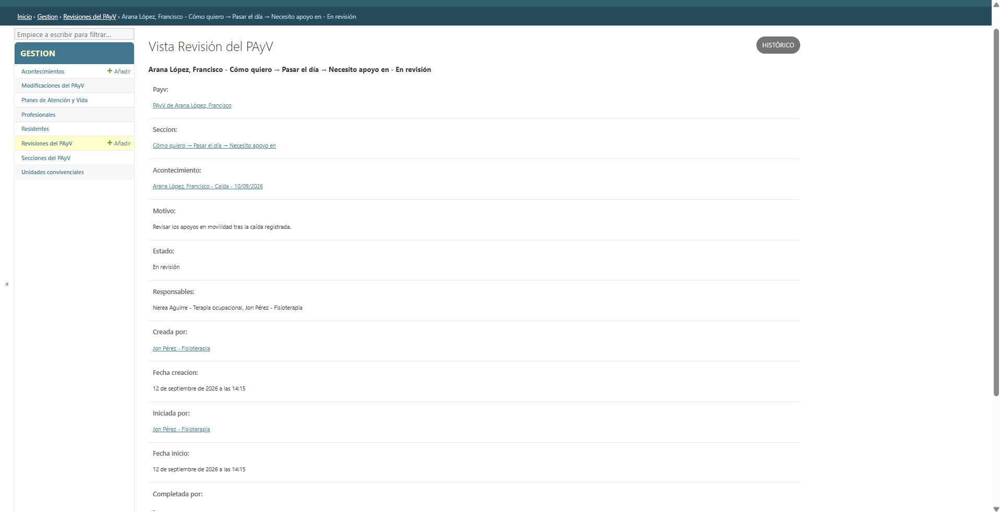
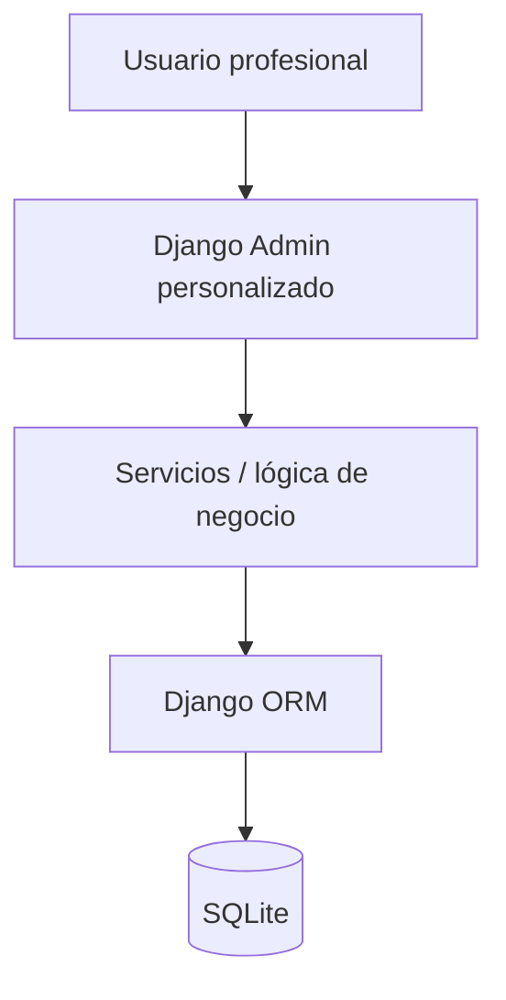
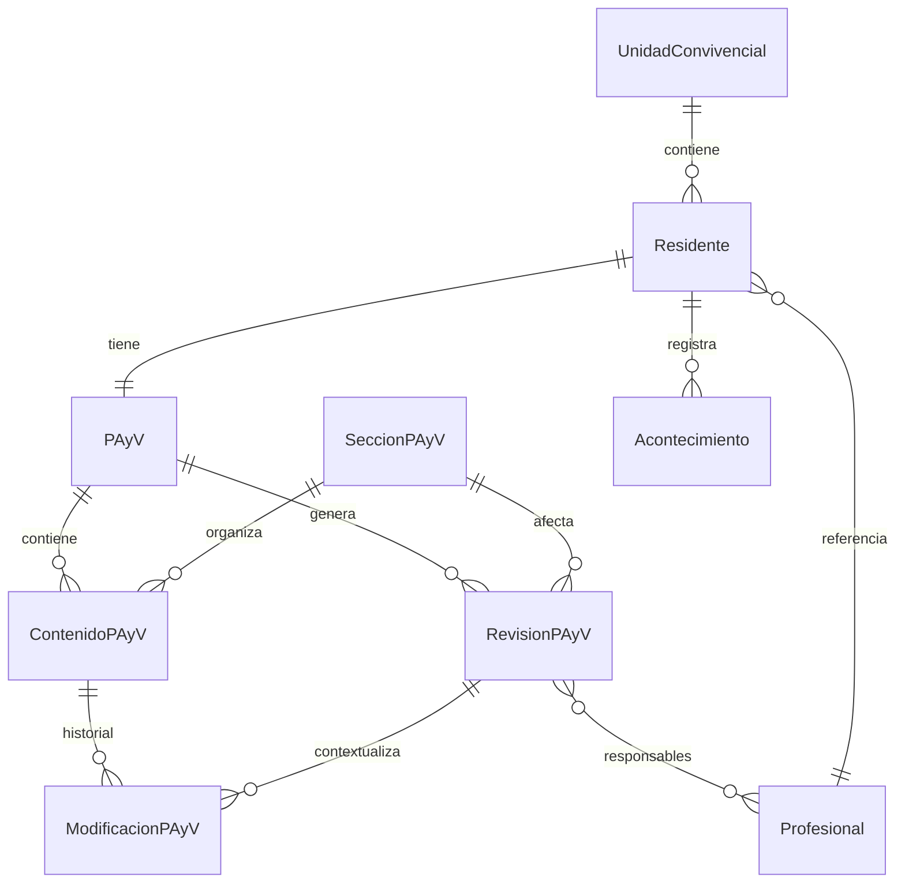
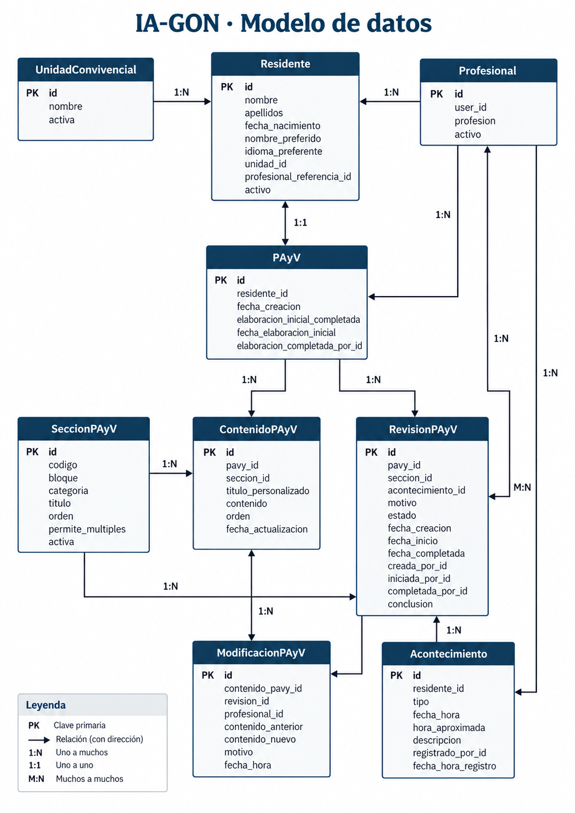

# IA-GON

### Gestión, coordinación y trazabilidad del Plan de Atención y Vida en centros residenciales

IA-GON es una aplicación web desarrollada con **Python y Django** para facilitar la gestión del **Plan de Atención y Vida (PAyV)** de personas que viven en centros residenciales.

El proyecto nace desde una perspectiva sociosanitaria y centrada en la persona. Su objetivo no es convertir el PAyV en un formulario cerrado o una lista de tareas, sino facilitar que los equipos profesionales puedan mantener información relevante, registrar acontecimientos, revisar cambios y conservar la trazabilidad de las decisiones adoptadas.

> **Estado del proyecto:** MVP funcional.
>
> **Uso previsto:** proyecto formativo y demostrativo con datos sintéticos. No está preparado para tratar datos sociosanitarios reales ni para utilizarse en producción.

## Vista rápida

Todas las capturas mostradas utilizan **datos sintéticos de demostración**.

### Panel de seguimiento



### Ficha de una persona residente



### Revisión del PAyV



---

## 1. Problema que aborda

En un centro residencial, el PAyV contiene información que puede cambiar con el tiempo:

- preferencias;
- rutinas;
- historia e identidad;
- necesidades de apoyo;
- objetivos;
- acontecimientos relevantes;
- decisiones acordadas por el equipo.

Cuando esta información se distribuye entre distintos documentos o no existe una trazabilidad clara, resulta difícil responder preguntas como:

- ¿Cuál es la información actual de esta persona?
- ¿Qué ha cambiado?
- ¿Por qué se modificó?
- ¿Quién realizó la modificación?
- ¿Existe alguna revisión pendiente?
- ¿Qué profesionales están implicados?
- ¿Qué acontecimiento originó la revisión?

IA-GON pretende centralizar este flujo en una aplicación sencilla y trazable.

---

## 2. Principios del proyecto

El diseño de IA-GON parte de varios principios:

- **Atención centrada en la persona.**
- El PAyV se considera un documento vivo.
- La persona residente no se reduce a información clínica.
- Los acontecimientos no modifican automáticamente el PAyV.
- Los cambios relevantes deben ser valorados antes de incorporarse.
- La aplicación facilita el trabajo interdisciplinar, pero no sustituye las decisiones del equipo.
- Se prioriza la trazabilidad de quién, cuándo y por qué realiza una modificación.
- La interfaz debe reducir carga documental y evitar burocracia innecesaria.

---

## 3. Funcionalidades principales

### Gestión de residentes

Permite consultar información básica de las personas residentes:

- nombre y apellidos;
- nombre preferido;
- fecha de nacimiento;
- fecha de ingreso;
- idioma preferente;
- unidad convivencial;
- profesional de referencia;
- estado activo/inactivo.

---

### Profesionales y unidades convivenciales

El sistema permite trabajar con:

- diferentes disciplinas profesionales;
- varias unidades convivenciales;
- un profesional de referencia asociado a cada residente.

El profesional de referencia es una relación contextual con la persona residente y **no un rol global del sistema**.

---

### Plan de Atención y Vida

Cada residente puede disponer de un PAyV organizado en cuatro grandes bloques:

1. **Quién soy**
2. **Qué quiero y qué necesito**
3. **Cómo quiero**
4. **Me encantaría**

Los contenidos se presentan agrupados para facilitar su lectura.

Ejemplo:

```text
QUIÉN SOY
└── Mi historia

CÓMO QUIERO
└── Pasar el día
    └── Necesito apoyo en
```

---

## 4. Elaboración inicial del PAyV

IA-GON diferencia entre la **elaboración inicial** y las posteriores revisiones.

El ciclo inicial puede ser:

```text
Sin contenido
      ↓
En elaboración
      ↓
Actualizado
```

Durante esta fase, los profesionales pueden incorporar información inicial al PAyV.

Cada incorporación queda registrada automáticamente con:

- profesional;
- fecha y hora;
- contenido creado;
- motivo: `Elaboración inicial del PAyV`.

Una vez finalizada la elaboración inicial, los contenidos ya no pueden modificarse mediante este mecanismo.

Los cambios posteriores deben pasar por el proceso de revisión.

---

## 5. Registro de acontecimientos

Los profesionales pueden registrar acontecimientos relevantes, por ejemplo:

- caída;
- hospitalización;
- regreso hospitalario;
- cambio significativo de situación;
- otros acontecimientos.

IA-GON diferencia entre:

```text
Fecha/hora del acontecimiento
```

y:

```text
Fecha/hora de registro en el sistema
```

La autoría del registro se asigna automáticamente al profesional autenticado.

---

## 6. Revisiones del PAyV

Un acontecimiento puede generar una revisión, aunque también pueden existir revisiones sin acontecimiento asociado.

Una revisión puede encontrarse en tres estados:

```text
🔴 Pendiente
🟠 En revisión
🟢 Completada
```

Puede asignarse a uno o varios profesionales.

La trazabilidad registra:

- profesional que crea la revisión;
- fecha de creación;
- profesional que inicia la revisión;
- fecha de inicio;
- profesionales responsables;
- profesional que completa la revisión;
- fecha de finalización;
- conclusión.

---

## 7. Histórico de modificaciones

Cuando se modifica un contenido del PAyV, IA-GON conserva:

```text
Contenido anterior
Contenido nuevo
Motivo del cambio
Profesional
Fecha y hora
Revisión asociada
```

De esta forma puede reconstruirse la evolución de la información sin sobrescribir silenciosamente el contenido anterior.

La elaboración inicial también genera histórico, aunque no necesita una revisión artificial.

---

## 8. Control de accesos

IA-GON utiliza el sistema de autenticación y permisos de Django.

Actualmente se diferencian principalmente:

### Administrador

Puede realizar tareas de administración técnica y configuración.

### Profesional

Puede:

- iniciar sesión;
- consultar residentes;
- consultar PAyV;
- consultar profesionales y unidades;
- registrar acontecimientos;
- crear revisiones;
- trabajar sobre las revisiones en las que está asignado;
- consultar el histórico.

No dispone de permisos genéricos para modificar directamente un PAyV o una revisión y saltarse la lógica de trazabilidad.

---

## 9. Panel de seguimiento

La página principal proporciona una visión general de IA-GON.

Incluye:

- residentes activos;
- profesionales;
- unidades convivenciales;
- estado de los PAyV;
- revisiones pendientes;
- revisiones en curso;
- accesos a los principales módulos.

Ejemplo con los datos sintéticos incluidos:

```text
12 residentes activos
8 profesionales
3 unidades convivenciales

8  🟢 Actualizados
1  🔴 Requiere revisión
1  🟠 En revisión
1  🔵 En elaboración
1  ⚪ Sin contenido
```

---

## 10. Arquitectura

IA-GON utiliza una arquitectura web basada en Django.



La lógica crítica no se concentra únicamente en la interfaz.

Las operaciones sensibles, como iniciar una revisión, modificar contenido o completar una revisión, se ejecutan mediante funciones de servicio que validan permisos y estados.

---

## 11. Modelo de datos

Principales entidades:



Diagrama visual del modelo de datos:



---

## 12. Tecnologías

- **Python**
- **Django 6.1.1**
- Django ORM
- SQLite
- HTML
- CSS
- Django Templates
- Django Authentication
- Django Admin personalizado
- python-dotenv

El proyecto se ha desarrollado y probado principalmente sobre Windows.

---

## 13. Estructura del proyecto

```text
IA-GON/
│
├── config/
│   ├── settings.py
│   ├── urls.py
│   ├── asgi.py
│   └── wsgi.py
│
├── gestion/
│   ├── fixtures/
│   │   └── secciones_payv.json
│   │
│   ├── management/
│   │   └── commands/
│   │       └── cargar_demo.py
│   │
│   ├── migrations/
│   ├── static/
│   ├── templatetags/
│   │   └── iagon_dashboard.py
│   │
│   ├── admin.py
│   ├── models.py
│   ├── services.py
│   └── tests.py
│
├── templates/
│   └── admin/
│       ├── base_site.html
│       ├── index.html
│       └── gestion/
│
├── .env.example
├── .gitignore
├── manage.py
├── README.md
└── requirements.txt
```

---

## 14. Instalación

### 1. Clonar el repositorio

```bash
git clone https://github.com/Ander-Josu/IA-GON.git
cd IA-GON
```

---

### 2. Crear un entorno virtual

Windows:

```powershell
python -m venv .venv
.\.venv\Scripts\Activate.ps1
```

Linux/macOS:

```bash
python -m venv .venv
source .venv/bin/activate
```

---

### 3. Instalar dependencias

```bash
pip install -r requirements.txt
```

---

## 15. Variables de entorno

El proyecto incluye:

```text
.env.example
```

Crea una copia denominada:

```text
.env
```

Ejemplo:

```env
DJANGO_SECRET_KEY=change-me
DJANGO_DEBUG=True
DJANGO_ALLOWED_HOSTS=127.0.0.1,localhost
```

Para generar una nueva `SECRET_KEY`:

```bash
python -c "from django.core.management.utils import get_random_secret_key; print(get_random_secret_key())"
```

La clave generada debe sustituir `change-me`.

El archivo `.env` está excluido del repositorio mediante `.gitignore`.

---

## 16. Crear la base de datos

Ejecuta:

```bash
python manage.py migrate
```

---

## 17. Cargar el catálogo del PAyV

IA-GON incluye un fixture con las secciones utilizadas por el PAyV:

```bash
python manage.py loaddata secciones_payv
```

---

## 18. Cargar datos sintéticos de demostración

Para generar un escenario completo:

```bash
python manage.py cargar_demo
```

El comando crea de forma reproducible:

- 3 unidades convivenciales;
- 8 profesionales;
- 12 residentes;
- PAyV en diferentes estados;
- contenidos iniciales;
- acontecimientos;
- revisiones;
- histórico de modificaciones.

El comando está diseñado para poder ejecutarse varias veces sin duplicar los registros principales.

---

## 19. Usuarios demo

Entre los usuarios sintéticos se incluyen:

| Usuario | Perfil |
|---|---|
| `ane.demo` | Gerocultora |
| `jon.demo` | Fisioterapia |
| `maite.demo` | Enfermería |
| `iker.demo` | Psicología |
| `leire.demo` | Trabajo Social |
| `nerea.demo` | Terapia Ocupacional |
| `unai.demo` | Educación Social |
| `mikel.demo` | Medicina |

Los usuarios creados por primera vez mediante `cargar_demo` utilizan como contraseña inicial:

```text
IaGon_Demo_2026!
```

> Estas credenciales pertenecen exclusivamente al entorno sintético de demostración y no deben reutilizarse en sistemas reales.

---

## 20. Crear un administrador

Opcionalmente:

```bash
python manage.py createsuperuser
```

---

## 21. Ejecutar la aplicación

```bash
python manage.py runserver
```

Abrir:

```text
http://127.0.0.1:8000/admin/
```

---

## 22. Tests automáticos

La lógica crítica del sistema dispone de pruebas automatizadas.

Ejecutar:

```bash
python manage.py test gestion
```

Actualmente se comprueban, entre otros:

- creación de contenido inicial con trazabilidad;
- imposibilidad de finalizar un PAyV vacío;
- bloqueo del flujo inicial después de finalizarlo;
- control de profesionales responsables;
- revisión multiprofesional;
- trazabilidad de creación, inicio, modificación y cierre;
- bloqueo del cierre por profesionales no responsables.

Resultado esperado:

```text
Ran 6 tests in ...
OK
```

---

## 23. Seguridad y privacidad

El repositorio no debe incluir:

- `.env`;
- claves secretas;
- contraseñas personales;
- bases de datos reales;
- información identificativa de residentes reales.

Los datos incluidos mediante `cargar_demo` son **sintéticos y ficticios**.

La base de datos local `db.sqlite3` está excluida mediante `.gitignore`.

---

## 24. Alcance actual del MVP

IA-GON permite actualmente:

- autenticación;
- gestión de usuarios y profesionales;
- unidades convivenciales;
- residentes;
- profesional de referencia;
- elaboración inicial del PAyV;
- organización del PAyV en bloques;
- acontecimientos;
- revisiones;
- responsables múltiples;
- estados;
- histórico de modificaciones;
- trazabilidad temporal y profesional;
- panel de seguimiento;
- datos demo reproducibles;
- tests automáticos.

---

## 25. Límites actuales

El proyecto es un MVP y no pretende todavía ser un sistema listo para explotación clínica o residencial real.

Entre otras cuestiones, actualmente no incluye:

- despliegue productivo;
- integración con historias sociosanitarias;
- notificaciones automáticas;
- firma electrónica;
- interoperabilidad sanitaria;
- permisos por unidad a nivel de fila;
- gestión documental externa;
- auditoría normativa completa;
- integración con inteligencia artificial.

---

## 26. Posibles evoluciones

Algunas líneas futuras podrían incluir:

- notificaciones ante revisiones pendientes;
- paneles específicos por profesional;
- filtros por unidad o profesional de referencia;
- seguimiento temporal del PAyV;
- generación de informes;
- exportación a PDF;
- integración con fuentes documentales;
- IA generativa como apoyo a la redacción;
- transcripción de entrevistas;
- RAG sobre documentación sociosanitaria;
- integración con sistemas externos.

Cualquier incorporación de inteligencia artificial debería mantener siempre la revisión humana y evitar que el sistema tome decisiones asistenciales de forma autónoma.

---

## 27. Contexto del proyecto

IA-GON ha sido desarrollado como proyecto final dentro de una formación en **Programación Python**.

El proyecto combina desarrollo de software con conocimiento del ámbito de la gerontología, la atención residencial y la atención centrada en la persona.

La intención es demostrar cómo Python y Django pueden utilizarse para abordar un problema de coordinación y trazabilidad propio del ámbito sociosanitario.

---

## Licencia

Este proyecto se publica con fines de **portfolio y demostración**. No se concede una licencia de código abierto para su reutilización, modificación o redistribución.

Copyright © 2026 Ander Josu Garigorta Barba. Todos los derechos reservados.

---

## Autor

**Ander Josu Garigorta Barba**

Perfil orientado a la aplicación de Python, datos e inteligencia artificial en:

- envejecimiento;
- salud digital;
- gerontología;
- servicios sociales;
- atención residencial.